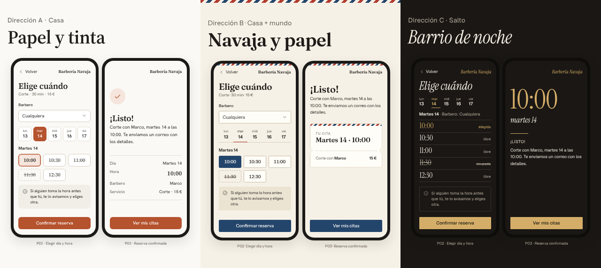

# System-agents

**Orquesta**: un sistema único de vibe coding para Claude Code, pensado para personas que no programan. Conversas con un solo agente, el **orquestador**, en lenguaje natural. Él te guía por cinco etapas para que veas tu app antes de construirla: visión, funcionalidades, lógica, experiencia e implementación. En la etapa de experiencia, un **diseñador** te propone tres estilos con tus pantallas reales, partiendo de un estilo de la casa cálido y editorial, y tú eliges. Después dirige a un equipo técnico (arquitecto, builders de frontend y backend, reviewer) que la construye por fases, y a un equipo de pruebas que evalúa cada fase contra lo que pediste. Todos trabajan con la memoria del proyecto.

> **Estado:** v1.1 implementada en [`plugins/orquesta`](plugins/orquesta/).

## Instalación

En Claude Code, dentro de la carpeta de tu proyecto:

```text
/plugin marketplace add fastc0de/system-agents
/plugin install orquesta@system-agents --scope project
```

Después escribe lo que quieres construir, por ejemplo: «Quiero una app para que mi barbería reciba reservas online». Necesitas `node` instalado.

## Documentación

- **[README del plugin](plugins/orquesta/README.md):** uso, equipo, reglas y skills.
- **[Visión del sistema](docs/concepto/VISION-DEL-SISTEMA.md):** el diseño completo y por qué es así.
- **[Conversación por etapas](docs/concepto/ETAPAS-DE-CONVERSACION.md):** cómo te habla el orquestador, qué ves y qué decides en cada etapa, y los modos de construcción.
- **[Sistema de pruebas](docs/concepto/SISTEMA-DE-PRUEBAS.md):** cuatro niveles, jefe de pruebas con cuatro testers y registro de fallos.
- **[Estilo de la casa](plugins/orquesta/skills/diseno/references/estetica-de-la-casa.md):** la estética por defecto, cómo se hace original en cada proyecto y las tres direcciones.
- **[Ejemplo: Barbería Navaja](ejemplos/barberia/):** la capa de producto que produce el orquestador, con sus diagramas, y las tres direcciones visuales del diseñador.



## Diagramas del sistema

Cada uno es un `.excalidraw` editable, con su vista previa `.png`:

1. [Arquitectura](docs/concepto/diagramas/01-arquitectura.png)
2. [Ciclo de vida](docs/concepto/diagramas/02-ciclo-de-vida.png)
3. [Memoria integrada y contexto](docs/concepto/diagramas/03-memoria-y-contexto.png)
4. [Anatomía de una funcionalidad](docs/concepto/diagramas/04-anatomia-de-una-funcionalidad.png)
5. [Conversación por etapas](docs/concepto/diagramas/05-etapas-de-conversacion.png)
6. [Sistema de pruebas](docs/concepto/diagramas/06-sistema-de-pruebas.png)

Para editar un diagrama, abre el `.excalidraw` en [excalidraw.com](https://excalidraw.com) (menú *Open*) o con la extensión de Excalidraw de VS Code.

## Desarrollo

```text
cd plugins/orquesta && node --test tests/*.test.js
claude plugin validate plugins/orquesta
```
