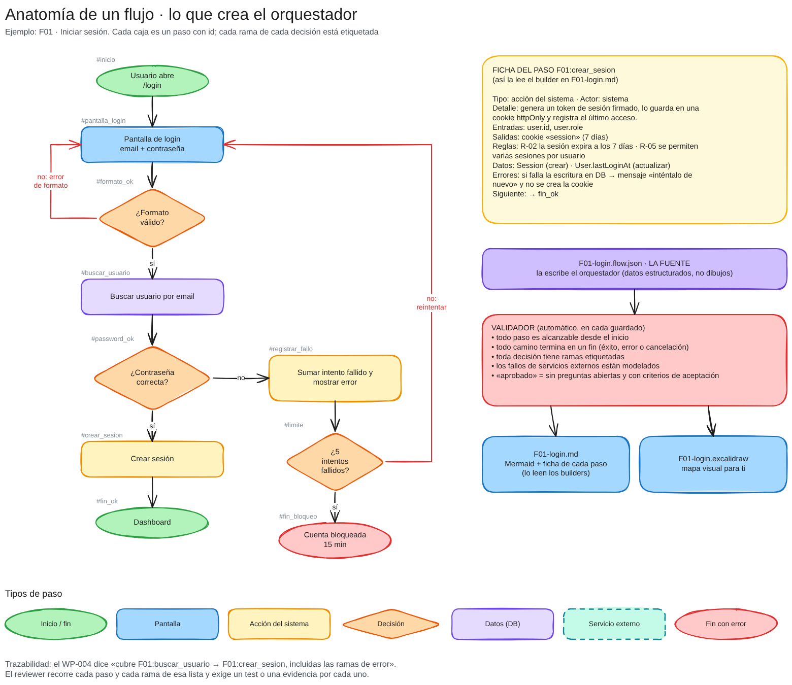

# Visión del sistema de agentes · concepto v0

> **Estado:** concepto para discutir. Todavía no hay nada implementado. Este documento describe qué hará el sistema, cómo trabajará y qué decisiones necesito de ti antes de construirlo (sección 14).

Diagramas (ábrelos en [excalidraw.com](https://excalidraw.com) con *Open*, o con la extensión de Excalidraw de VS Code; cada uno tiene su vista previa `.png` al lado):

| Diagrama | Qué explica |
| --- | --- |
| [`01-arquitectura.excalidraw`](diagramas/01-arquitectura.excalidraw) | Quién habla con quién, quién escribe qué y qué reglas se cumplen solas |
| [`02-ciclo-de-vida.excalidraw`](diagramas/02-ciclo-de-vida.excalidraw) | De la idea a la app: fases, gates y bucles de corrección |
| [`03-memoria-y-contexto.excalidraw`](diagramas/03-memoria-y-contexto.excalidraw) | Cómo tu `project-memory` llega a cada subagente y cómo se actualiza |
| [`04-anatomia-de-un-flujo.excalidraw`](diagramas/04-anatomia-de-un-flujo.excalidraw) | Qué crea el orquestador: un flujo de ejemplo, la ficha de un paso y el validador |

---

## 1. En una frase

Tú conversas **solo con el orquestador**. Él entiende tu visión, la convierte en **diagramas de flujo detallados** (el contrato), parte el trabajo en **paquetes pequeños y verificables** y los delega a **subagentes especializados** que siempre nacen con la **memoria del proyecto** en contexto. Ningún paquete se da por terminado sin que **otro agente lo verifique con evidencia**.


---

## 2. Por qué así: lo que rompe el vibe coding sin disciplina

Después de muchos proyectos construidos con IA, los fallos casi siempre son los mismos:

| Síntoma | Causa real | Respuesta del sistema |
| --- | --- | --- |
| "Construyó algo distinto a lo que pedí" | La intención vivía solo en el chat y se perdió entre sesiones | El **blueprint** (flujos aprobados) es el contrato escrito; nadie construye sin él |
| "Inventó casos que no existían" o "olvidó los casos de error" | Nadie definió qué pasa en cada rama | Cada decisión del flujo tiene ramas etiquetadas; un **validador** rechaza flujos incompletos |
| "Dijo que estaba listo y no funcionaba" | El mismo agente que escribió el código se autoevaluó | Un **reviewer independiente** ejecuta los tests y contrasta con el flujo |
| "Cada sesión empieza de cero" | El contexto no persiste | **Tu `project-memory`**, inyectada automáticamente en cada agente |
| "Rompió algo que ya funcionaba" | Tareas enormes que tocan medio proyecto | **Paquetes de trabajo** pequeños, con archivos en alcance y límites de tamaño |
| "El agente principal se volvió lento y confuso" | Su contexto se llenó de código y logs | El orquestador **no lee ni escribe código**: delega y recibe resúmenes |
| "Las reglas del prompt se ignoraron" | Las instrucciones son sugerencias para un modelo | Las reglas críticas se cumplen con **hooks**: código determinista que bloquea |

---

## 3. Principios de diseño

1. **Una sola voz.** Tú hablas con un único agente. Los demás nunca te piden nada directamente; todo pasa por el orquestador.
2. **El contrato antes que el código.** Nada se construye sin un flujo aprobado por ti.
3. **Separar pensar de ejecutar.** El orquestador piensa, diseña y decide contigo; los subagentes ejecutan tareas acotadas con contexto limpio.
4. **Nadie se califica a sí mismo.** El builder construye; el reviewer verifica.
5. **Tareas pequeñas, verticales y verificables.** Mejor 10 entregas de 1 hora verificadas que una de 10 horas sin verificar.
6. **La memoria es evidencia, no opinión.** Se escribe solo con lo verificado, en hitos, y la escribe un único agente: tu `project-archiver`.
7. **Lo que importa se garantiza con código.** Si una regla es crítica (quién escribe dónde, reportes con evidencia, contexto inyectado), la hace cumplir un hook, no un "por favor" en el prompt.
8. **Jerarquía plana.** Un orquestador y trabajadores. Los subagentes no pueden delegar en otros subagentes, así se evita el teléfono descompuesto.

---

## 4. El equipo

| Rol | Qué hace | Puede escribir en | No puede | Modelo propuesto |
| --- | --- | --- | --- | --- |
| **Orquestador** (hilo principal) | Conversa contigo, es dueño de la visión, diseña los flujos, pide planes, delega, hace cumplir los gates, te reporta | `docs/blueprint/**` (y el estado del tablero en `docs/plan/PLAN.md`, ver decisión 1) | Escribir código, tests o memoria; leer archivos grandes (para eso usa al scout) | `opus` · esfuerzo alto |
| **Scout** | Explora el código y responde preguntas concretas ("¿dónde está la auth?", "¿qué ORM usa?") | Nada (solo lectura) | Editar | `haiku` · rápido y barato |
| **Planner** | Convierte los flujos aprobados de un hito en paquetes de trabajo (WP) con criterios de aceptación y trazabilidad | `docs/plan/**` | Tocar código o blueprint | `opus` |
| **Builder** (×N) | Implementa **un** WP y sus tests, ejecuta la verificación y entrega un reporte | Código y tests dentro del alcance del WP | Escribir en `docs/blueprint/`, `docs/plan/` o `docs/project-memory/`; hacer commit; inventar comportamiento | `sonnet` |
| **Reviewer** | Verifica el WP de forma independiente: ejecuta los tests, recorre cada paso y rama del flujo, revisa el alcance. Emite PASS o FAIL con hallazgos | Nada | Editar, hacer commit | `opus` |
| **Project-archiver** (tu agente, sin cambios) | `init`, `sync` y `archive` de la memoria con verificación de evidencia | `docs/project-memory/**` | Todo lo demás (ya lo garantiza tu `archiver-guard`) | `sonnet` |

**Por qué el orquestador es el hilo principal y no un subagente:** solo el hilo principal conversa contigo, y es quien lanza subagentes. Claude Code permite que el agente principal de la sesión sea un agente personalizado: con `claude --agent orquestador` o, más cómodo, con un `settings.json` dentro del plugin que lo activa por defecto. Lo verifiqué en la documentación actual de Claude Code.

**Por qué esos modelos:** el razonamiento caro (entender la visión, diseñar flujos, planificar, juzgar calidad) va en `opus`; la ejecución mecánica y repetitiva va en `sonnet`; la búsqueda, en `haiku`. Hay una alternativa económica en la decisión 4.

---

## 5. Cómo trabajas tú

Tu trabajo se reduce a tres cosas: **contar la visión, responder preguntas y aprobar.** Nunca tienes que redactar prompts para los subagentes, decidir quién hace qué ni revisar código si no quieres.

Así se vería una sesión típica:

```text
Tú:   Quiero una app para que mi barbería reciba reservas online.

Orq:  Antes de diseñar, 4 preguntas:
      1) ¿Quién reserva: clientes sin cuenta o con cuenta?
      2) ¿Un barbero o varios, cada uno con su agenda?
      3) ¿Se cobra al reservar o en el local?
      4) ¿Web, móvil o ambas para empezar?

Tú:   (respondes)

Orq:  Escribí docs/blueprint/VISION.md. Resumen: ... ¿La apruebas?
Tú:   Sí.

Orq:  Propongo 4 flujos: F01 Reservar cita, F02 Cancelar/reprogramar,
      F03 Agenda del barbero, F04 Recordatorios.
      F01 está en docs/blueprint/flows/F01-reservar-cita.excalidraw.
      Dudas abiertas en F01:
      - ¿Qué pasa si dos clientes eligen el mismo hueco a la vez?
      - ¿Con cuánta anticipación mínima se puede reservar?

Tú:   El primero que confirma gana; mínimo 2 horas.

Orq:  F01 actualizado (v2), sin dudas abiertas. ¿Lo apruebas?
Tú:   Aprobado.

Orq:  Hito M1 «Reserva básica»: 6 paquetes de trabajo, empezando por el
      esqueleto de la app y los tests. ¿Arranco?
Tú:   Dale.

Orq:  WP-001 ✅ esqueleto (reviewer PASS, 4 tests)
      WP-002 ✅ modelo de datos de citas (PASS, 11 tests)
      WP-003 ❌→✅ selección de hueco (FAIL: faltaba la rama «hueco ya
      tomado»; corregido en el 2º ciclo, PASS)
      ...
      Hito M1 cerrado. Memoria sincronizada. Para probarlo: ...
```

**Tus aprobaciones (gates):**

| Gate | Qué apruebas | Por qué tú |
| --- | --- | --- |
| G1 · Visión | `VISION.md`: problema, usuarios, alcance y no-alcance, éxito | Es tu producto |
| G2 · Flujos | Cada flujo del hito, sin preguntas abiertas | Es el contrato; después es caro cambiarlo |
| G3 · Plan del hito | Un resumen de los WPs y el orden (aprobación ligera) | Para que sepas qué viene y cuánto es |
| G4 · Demo del hito | Pruebas lo construido | Validación real, no solo tests |

El gate de cada WP (PASS/FAIL) **no** lo decides tú: lo decide el reviewer con evidencia. Solo te enteras si algo se escala.

---

## 6. Ciclo de vida: fases y gates


| Fase | Quién | Entrada | Salida | Gate |
| --- | --- | --- | --- | --- |
| 0 · Orientar | Orquestador | Repo (vacío o existente) | Memoria y blueprint cargados; si no hay memoria, ofrece `init` | — |
| 1 · Visión | Orquestador ↔ tú | Tu idea | `docs/blueprint/VISION.md` | G1 |
| 2 · Blueprint | Orquestador ↔ tú (scout si hay código existente) | Visión aprobada | `BLUEPRINT.md` + `flows/*` aprobados. Sync de memoria (un spec aprobado es un hito para tu skill) | G2 |
| 3 · Plan | Planner | Flujos aprobados del hito | `docs/plan/PLAN.md` + `WP-xxx.md` | G3 |
| 4 · Construir | Builder → Reviewer, por WP | Un WP | Código y tests + reporte + veredicto | PASS por WP |
| 5 · Cierre de hito | Reviewer (verificación integral) → Archiver | Todos los WPs en PASS | Memoria sincronizada + demo | G4 |

**Bucles de corrección:**

- **FAIL del reviewer:** el mismo builder recibe los hallazgos y corrige (lo retoma con su contexto, sin empezar de cero). Máximo **2 ciclos**.
- **Segundo FAIL:** se escala. El orquestador decide si el WP estaba mal partido (replanifica) o si el flujo tenía un hueco (lo corrige contigo).
- **Cambio de idea a mitad de camino:** entra siempre por el orquestador, nunca directo a un builder. Se actualiza el flujo (versión +1), se marcan los WPs afectados y se replanifica.

---

## 7. El blueprint: el orquestador como arquitecto de flujos

Esta es la capacidad exclusiva del orquestador: **es el único que crea los archivos que describen cómo funciona la app**, y es lo único que escribe. Los builders los leen con especial atención porque son su contrato.



### 7.1 Qué archivos crea

```text
docs/blueprint/
  VISION.md                     problema, usuarios, alcance, no-alcance, éxito
  BLUEPRINT.md                  modelo de datos (entidades y relaciones), reglas
                                de negocio numeradas (R-01, R-02…), pantallas y
                                rutas, roles y permisos, requisitos no funcionales,
                                glosario, índice de flujos
  flows/
    F01-reservar-cita.flow.json   LA FUENTE: la escribe el orquestador
    F01-reservar-cita.md          generado: diagrama Mermaid + ficha de cada paso
    F01-reservar-cita.excalidraw  generado: mapa visual con carriles por actor
    INDEX.md                      generado: todos los flujos, estado, versión y mapa
```

### 7.2 Por qué la fuente es un archivo de datos y no un dibujo

Un modelo de lenguaje es muy bueno describiendo lógica y muy malo calculando coordenadas de cajas y flechas. Por eso el orquestador **no dibuja**: describe el flujo como datos estructurados (pasos, ramas, reglas, errores) y un **generador determinista** produce las dos vistas:

- **`.md` con Mermaid:** se ve en GitHub y en VS Code, e incluye la **ficha completa de cada paso**. Es lo que leen los builders.
- **`.excalidraw`:** el mapa visual para ti, con colores por tipo de paso y carriles por actor (cliente, sistema, servicio externo).

Las dos vistas salen de la misma fuente, así que nunca se contradicen. Y como la fuente son datos, se pueden **validar** automáticamente.

### 7.3 Tipos de paso

| Tipo | Para qué | Forma |
| --- | --- | --- |
| `start` / `end` | Inicio y finales (éxito, error o cancelación) | Óvalo (rojo si es fin con error) |
| `screen` | Lo que ve y hace el usuario | Rectángulo azul |
| `action` | Lo que hace el sistema | Rectángulo amarillo |
| `decision` | Una bifurcación con ramas etiquetadas | Rombo naranja |
| `data` | Lectura o escritura de datos | Rectángulo morado |
| `external` | Llamada a un servicio de terceros (pagos, email…) | Rectángulo verde agua punteado |
| `wait` | Espera asíncrona (webhook, temporizador, cola) | Rectángulo gris |
| `subflow` | Remite a otro flujo (`F03`) | Rectángulo rosa |

### 7.4 La ficha de cada paso: aquí vive "cada detalle"

El diagrama muestra la forma; la ficha cuenta todo lo demás. Cada paso tiene un id estable (`F01:crear_sesion`) y estos campos:

| Campo | Contenido |
| --- | --- |
| Detalle | Qué ocurre exactamente, en lenguaje claro |
| Actor | Quién lo ejecuta (cliente, sistema, Stripe…) |
| Entradas / Salidas | Datos que recibe y produce |
| Reglas | Reglas de negocio que aplica (`R-02`, o la regla escrita) |
| Datos | Entidades que lee o modifica (`Session (crear)`) |
| UI | Para pantallas: elementos, estados vacíos y de carga, mensajes |
| Errores | Qué puede fallar y a qué rama lleva cada fallo |
| Siguiente | Ramas de salida con su condición |

Además, cada flujo tiene **disparador**, **precondiciones**, **postcondiciones**, **criterios de aceptación**, **preguntas abiertas** e **historial de cambios**.

### 7.5 El validador: la garantía de que no falta nada

Cada vez que el orquestador guarda un flujo, un hook lo valida y regenera las vistas. Si algo falla, el orquestador recibe los errores al instante y debe corregirlos:

- Todo paso es alcanzable desde el inicio y todo camino termina en un fin: sin callejones sin salida.
- Toda decisión tiene al menos dos ramas, todas etiquetadas.
- Toda llamada a un servicio externo tiene modelada su rama de fallo.
- Todo paso (salvo inicio y fin) tiene su detalle.
- Un flujo **aprobado** no puede tener preguntas abiertas y debe tener criterios de aceptación.
- Las referencias a otros flujos (`subflow`) existen.

### 7.6 Estados y versiones

`draft` → `review` → `approved` → (`deprecated`). Solo se construye a partir de flujos `approved`. Cambiar un flujo aprobado sube su versión y deja anotado qué cambió; los WPs que lo cubren se marcan para revisar.

### 7.7 Trazabilidad

Cada WP declara qué pasos y ramas cubre (`F01:buscar_usuario → F01:crear_sesion, incluidas las ramas de error`). El reviewer recorre exactamente esa lista y exige un test o una evidencia por cada elemento. Al final de un hito, cada paso de cada flujo aprobado está cubierto por algún WP.

---

## 8. Disciplina de cargas de trabajo

Esta es la parte que más decide la calidad final.

### 8.1 Hitos

Un **hito** es un conjunto de WPs que entrega algo que **puedes probar**. El primero siempre es el **esqueleto andante**: la app arranca, hay framework de tests, un comando de verificación y un flujo mínimo de punta a punta. A partir de ahí, cada hito añade flujos completos (cortes verticales), no capas sueltas ("todo el backend primero").

### 8.2 El paquete de trabajo (WP)

Lo crea el planner y es todo lo que un builder necesita:

```markdown
# WP-004: Login con email y contraseña
- Estado: todo | in-progress | review | done | blocked
- Hito: M1
- Cubre: F01:buscar_usuario → F01:crear_sesion (incluye ramas no/sí de password_ok y limite)
- Reglas: R-02, R-05
- Depende de: WP-002
- Tamaño: M
- Archivos en alcance: src/auth/login.ts, src/auth/session.ts, tests/auth/login.test.ts
- Solo referencia: src/db/schema.ts

## Objetivo
## Notas de implementación (restricciones, no código)
## Criterios de aceptación (cada uno ligado a un paso o rama)
- [ ] CA1 (F01:password_ok → no): contraseña incorrecta suma un intento y muestra el error
- [ ] CA2 (F01:limite → sí): al 5º fallo la cuenta queda bloqueada 15 min
## Verificación
- `npm test -- auth`
## Fuera de alcance
```

### 8.3 Límites

| Regla | Valor propuesto | Por qué |
| --- | --- | --- |
| Tamaño de WP | **S:** ≤3 archivos, ~150 líneas · **M:** ≤8 archivos, ~400 líneas · **L: prohibido**, se divide | Los errores crecen más rápido que el tamaño |
| Builders en paralelo | **1** por defecto; máx. **3** solo si no comparten archivos ni dependencias | Dos agentes editando lo mismo = conflictos silenciosos |
| Ciclos de corrección | Máx. **2** por WP; después se escala | Evita bucles caros que no convergen |
| WPs por hito | Orientativo: 4–10 | Hitos más grandes retrasan tu feedback |
| Preguntas por ronda (visión y flujos) | 3–4 | Conversación ágil, sin interrogatorios |

### 8.4 Definición de terminado (un WP pasa a `done` solo si…)

1. Todos los criterios de aceptación tienen evidencia (test o verificación concreta).
2. El comando de verificación pasa, **ejecutado por el reviewer**, no solo por el builder.
3. No hay archivos modificados fuera del alcance sin justificar.
4. Se implementaron las ramas de error del flujo, no solo el camino feliz.
5. Sin tests desactivados, sin `TODO` que oculten funcionalidad pendiente y sin secretos en el código.
6. El orquestador actualizó el tablero y hay commit.

### 8.5 Protocolos de parada: el builder no improvisa

| Señal en el reporte | Cuándo | Qué hace el orquestador |
| --- | --- | --- |
| `BLUEPRINT GAP` | El flujo no responde una duda, o se contradice | Te pregunta, actualiza el flujo y retoma el WP |
| `SCOPE GAP` | Hace falta tocar archivos fuera del alcance de forma importante | Replanifica: amplía el WP o crea otro |
| `BLOCKED` | Falla algo ajeno al WP (dependencia, entorno, test roto previo) | Lo resuelve en otro WP o te avisa |

Para dudas triviales y reversibles, el builder elige la opción conservadora y la declara como **supuesto** en su reporte, para que el reviewer y el orquestador la vean.

### 8.6 Contratos de reporte

Un hook impide que el builder o el reviewer terminen sin el bloque de reporte. Si falta, el subagente recibe la orden de completarlo:

```markdown
## BUILD REPORT                        ## REVIEW VERDICT
- WP: WP-004                           - WP: WP-004
- Estado: done | blocked |             - Veredicto: PASS | FAIL
  blueprint-gap | scope-gap            ### Verificación ejecutada
### Archivos cambiados                 - `npm test -- auth` → 12 passed
### Criterios de aceptación            ### Criterios (uno por uno)
### Verificación (comando → resultado) ### Hallazgos [bloqueante|mayor|menor]
### Supuestos                          ### Notas para memoria
### Preguntas para el orquestador
```

### 8.7 Higiene de contexto

- El orquestador **no lee archivos grandes ni logs**. Si necesita saber algo del código, pregunta al scout y recibe un resumen.
- Cada encargo a un subagente es un **brief autocontenido**: la ruta del WP, los pasos del flujo que cubre y qué se espera de vuelta. El resto del contexto (memoria y blueprint) lo inyecta el hook.
- Los subagentes devuelven reportes cortos y estructurados, no transcripciones.

### 8.8 Git

- Una rama por hito (`m1-reserva-basica`) y un commit por WP aprobado (`WP-004: login con email (F01)`).
- El builder nunca hace commit: solo se hace commit de lo que el reviewer aprobó.
- `push` y PRs solo cuando tú lo pidas.

---

## 9. Memoria integrada (tu `project-memory`)


**Tu sistema se integra tal cual.** No cambio su esquema ni su lógica: siguen siendo los mismos cinco archivos, el mismo `archive.js` y el mismo `project-archiver` con su guard. Así sigue siendo compatible con la versión de OpenCode.

| Momento | Qué pasa | Mecanismo |
| --- | --- | --- |
| Abres una sesión | El orquestador recibe `status.md` y luego carga el resto (`load`) | Tu hook `session-start` (ya existe) + instrucción del orquestador |
| Nace cualquier subagente | Recibe un **paquete de contexto**: `overview`, `architecture`, `status`, decisiones `accepted` vigentes, resumen de la visión e índice de flujos, más las reglas de su rol | Hook nuevo `SubagentStart`: inyecta contexto antes del primer mensaje del subagente (verificado en la doc de Claude Code) |
| El reviewer aprueba un WP | Anota "notas para memoria": comandos reales, hechos durables, decisiones tomadas | Contrato de reporte |
| Se aprueba el blueprint o se cierra un hito | El orquestador arma el evidence bundle y despacha al `project-archiver` (`sync`) | Tu skill, tal como está definida |
| `sessions.md` pasa de 10 entradas | Archivo sin pérdidas | Tu `archive.js` |

Detalles de diseño del paquete inyectado:

- **Tope de tamaño** (~4k tokens) con truncado explícito, para no inflar a cada subagente.
- **Marcado como dato, no como instrucción**, y advirtiendo que puede estar desactualizado: el repo manda (la misma filosofía que tu hook).
- **No incluye** `sessions.md` ni `archive/`: son historia, no contexto operativo.
- No se inyecta al `project-archiver`: él lee la memoria por su cuenta, como ya hace.

**Memoria y blueprint no se pisan:** la memoria dice **qué es verdad hoy** (estado, arquitectura real, decisiones vigentes); el blueprint dice **qué debe hacer la app** (comportamiento acordado). La memoria enlaza al blueprint y nunca copia su contenido, igual que tu skill ya enlaza specs y planes en vez de copiarlos.

---

## 10. Reglas que se cumplen solas (hooks)

Los agentes empaquetados en un plugin no pueden traer sus propios hooks (Claude Code los ignora por seguridad; lo confirmé en la documentación). Por eso las reglas viven en el `hooks.json` del plugin y distinguen al agente por el campo `agent_type` que Claude Code les pasa. Es el mismo patrón que ya usa tu `archiver-guard`.

| Hook | Evento | Qué garantiza |
| --- | --- | --- |
| **Guardia de roles** | `PreToolUse` | Cada rol escribe solo en su zona (tabla de la sección 11). El orquestador no puede escribir código; el builder no puede tocar el blueprint ni la memoria; el reviewer y el scout no editan. El orquestador solo puede delegar en agentes del equipo. Nadie fuera del builder lee `.env` ni llaves |
| **Inyección de contexto** | `SubagentStart` | Todo subagente nace con memoria + blueprint + reglas de su rol |
| **Control de reporte** | `SubagentStop` | Builder y reviewer no terminan sin su bloque de reporte; un builder que dice `done` sin comandos de verificación es devuelto a terminar |
| **Generador de flujos** | `PostToolUse` | Al guardar un `.flow.json`: valida, regenera `.md` y `.excalidraw`, actualiza `INDEX.md` y devuelve los errores al orquestador |
| **Recordatorio de gate** | `PostToolUse` sobre la delegación | Cuando un builder termina, recuerda al orquestador que el WP no está hecho hasta el PASS del reviewer |
| **Arranque** | `SessionStart` | Tu hook de memoria + un resumen del blueprint y del tablero |

---

## 11. Quién escribe dónde

| Ruta | Escribe | Lee |
| --- | --- | --- |
| `docs/blueprint/**` | Solo el orquestador (las vistas `.md` y `.excalidraw` las genera el hook) | Todos |
| `docs/plan/**` | Planner (crea y replanifica) · orquestador (solo el estado del tablero) | Todos |
| `docs/project-memory/**` | Solo `project-archiver` | Todos (inyectado) |
| Código, tests, configuración | Solo builders, dentro del alcance de su WP | Scout, reviewer |

---

## 12. Cómo se empaquetaría

Propongo que este repo sea un **marketplace de plugins de Claude Code** con dos plugins:

```text
System-agents/
  .claude-plugin/marketplace.json
  plugins/
    project-memory/      tu plugin, sin cambios
    orchestra/           el sistema nuevo
      .claude-plugin/plugin.json     depende de project-memory
      settings.json                  { "agent": "orchestrator" }
      agents/                        orchestrator, scout, planner, builder, reviewer
      skills/blueprint/              esquema de flujos, validador y generadores
      hooks/                         guardia de roles, contexto, reportes, render
```

- `orchestra` declara `project-memory` como **dependencia**: al instalarlo, tu memoria se activa con él. Así viene integrada por defecto sin fusionar el código ni romper tu plugin.
- El `settings.json` del plugin convierte al orquestador en el agente principal de la sesión. Por eso conviene **instalarlo por proyecto** y no globalmente (decisión 5).
- Instalación prevista:
  ```text
  /plugin marketplace add fastc0de/system-agents
  /plugin install orchestra@system-agents
  ```

---

## 13. Límites honestos y riesgos

| Límite | Mitigación |
| --- | --- |
| La guardia depende de que Claude Code envíe `agent_type` a los hooks (lo hace dentro de subagentes y con `--agent`). Si un entorno no lo envía, la guardia no actúa | Las instrucciones de cada agente repiten los límites; el reviewer revisa `git status` en busca de archivos fuera de alcance |
| Por shell (`Bash`) un builder podría escribir donde no debe; no se puede blindar cada comando | La guardia bloquea los casos obvios (redirecciones o `rm` sobre las rutas protegidas, `git commit/push/reset`), y el reviewer detecta lo demás |
| Los hooks necesitan `node` en el PATH | Igual que tu plugin actual: si falta, fallan abiertos y avisan |
| Un orquestador en `opus` con conversaciones largas cuesta más | Mantiene su contexto limpio (no lee código) y hay un modo económico (decisión 4) |
| El Excalidraw generado es un mapa, no el documento completo | El detalle completo vive en la ficha del `.md`; el mapa es para entender y discutir |
| El paralelismo en el mismo directorio de trabajo puede chocar | Secuencial por defecto; paralelo solo con archivos disjuntos, y con worktrees aislados en una versión posterior |
| Un flujo aprobado puede estar equivocado | El gate G4 (demo) y el control de cambios existen precisamente para eso |

---

## 14. Decisiones que necesito de ti

Cada una trae mi recomendación. Si estás de acuerdo con todas, basta con que me digas "de acuerdo con las recomendaciones".

| # | Decisión | Opciones | Recomiendo |
| --- | --- | --- | --- |
| 1 | ¿Qué puede escribir el orquestador? | (a) solo `docs/blueprint/**` · (b) además el estado del tablero en `docs/plan/PLAN.md` | **(b)**: sin eso, nadie lleva el estado del tablero sin gastar un subagente |
| 2 | ¿Quién hace los commits? | (a) el orquestador, uno por WP aprobado · (b) tú, manualmente | **(a)**, y `push` solo cuando lo pidas |
| 3 | Paralelismo de builders | (a) secuencial en v1 · (b) hasta 3 en paralelo desde el inicio · (c) paralelo con worktrees aislados | **(a)** en v1 y **(c)** cuando el flujo esté probado |
| 4 | Modelos | (a) calidad: orquestador, planner y reviewer en `opus`, builder en `sonnet`, scout en `haiku` · (b) económico: solo el orquestador en `opus`, el resto en `sonnet` o `haiku` | **(a)**; (b) para proyectos pequeños |
| 5 | Activación del orquestador | (a) por proyecto · (b) global, en todas las sesiones | **(a)** |
| 6 | Fuente de los diagramas | (a) datos estructurados → Mermaid + Excalidraw generados · (b) Mermaid escrito a mano | **(a)**: validable, coherente y con fichas por paso |
| 7 | Idioma | (a) prompts de agentes en inglés y conversación y blueprint en español · (b) todo en español | **(a)**: consistente con tu plugin; tú solo ves español |
| 8 | Stack por defecto | (a) el orquestador lo pregunta en cada proyecto · (b) defines un stack de la casa (p. ej. Next.js + Supabase) que usa salvo que digas otra cosa | Dime si tienes uno preferido |
| 9 | Granularidad de aprobación | (a) apruebas cada flujo · (b) apruebas todos los flujos del hito juntos | **(a)** al principio; **(b)** cuando confíes en el sistema |
| 10 | Empaquetado | (a) marketplace con dos plugins (`orchestra` depende de `project-memory`) · (b) un solo plugin fusionado | **(a)**: tu plugin queda intacto y reutilizable |

---

## 15. Próximos pasos

1. **Tú:** revisas este documento y los cuatro diagramas, y respondes las decisiones de la sección 14 (o las cambias).
2. **Yo:** ajusto el concepto con tus respuestas.
3. Construimos el sistema **usando su propio método**: este documento hace de `VISION.md`; después vendrán los flujos del propio sistema y la implementación por entregas:
   - **v0.1 · Núcleo:** orquestador + builder + reviewer + inyección de memoria + contratos de reporte.
   - **v0.2 · Blueprint:** esquema de flujos, validador y generadores Mermaid/Excalidraw.
   - **v0.3 · Guardias:** propiedad por rol, protocolos de parada y recordatorios de gate.
   - **v0.4 · Escala:** planner y scout completos, paralelismo con worktrees.
