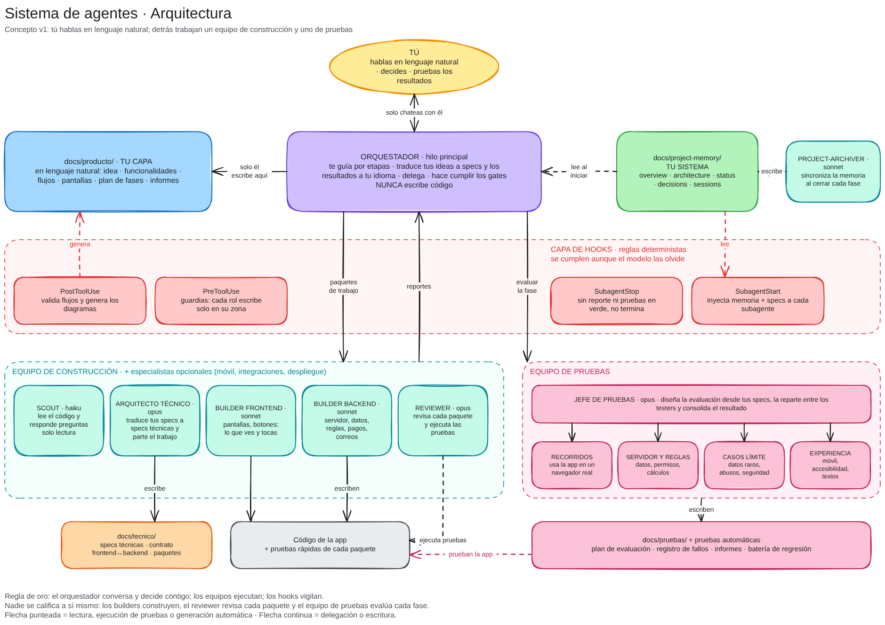
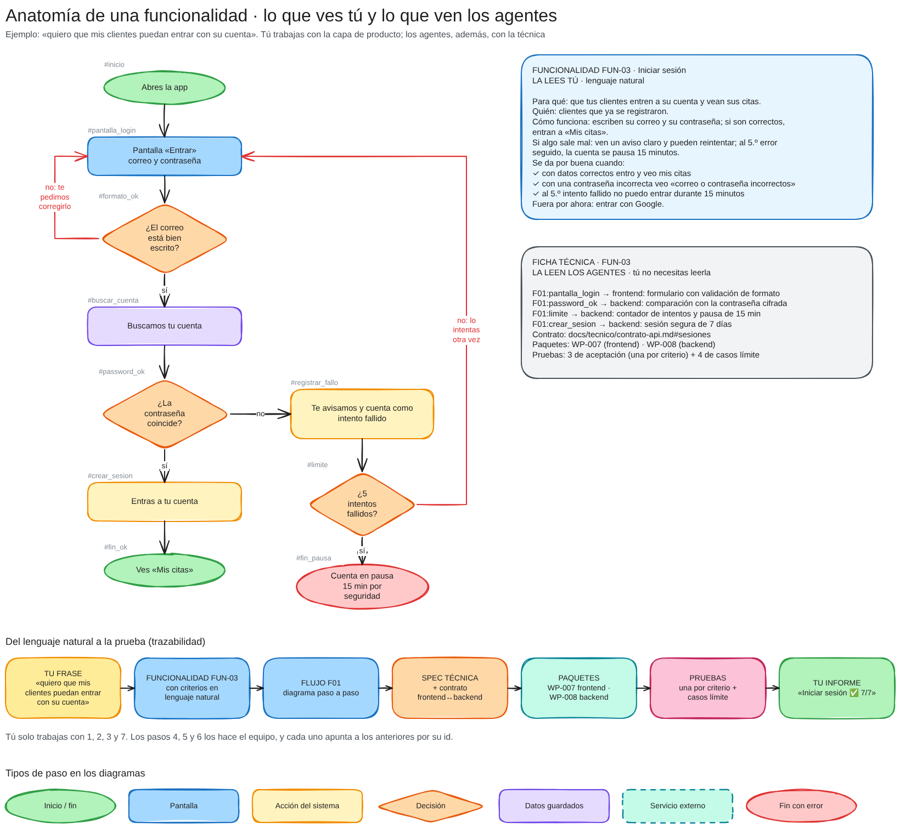
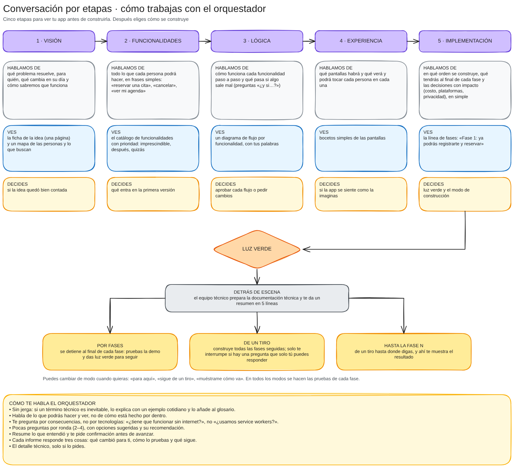
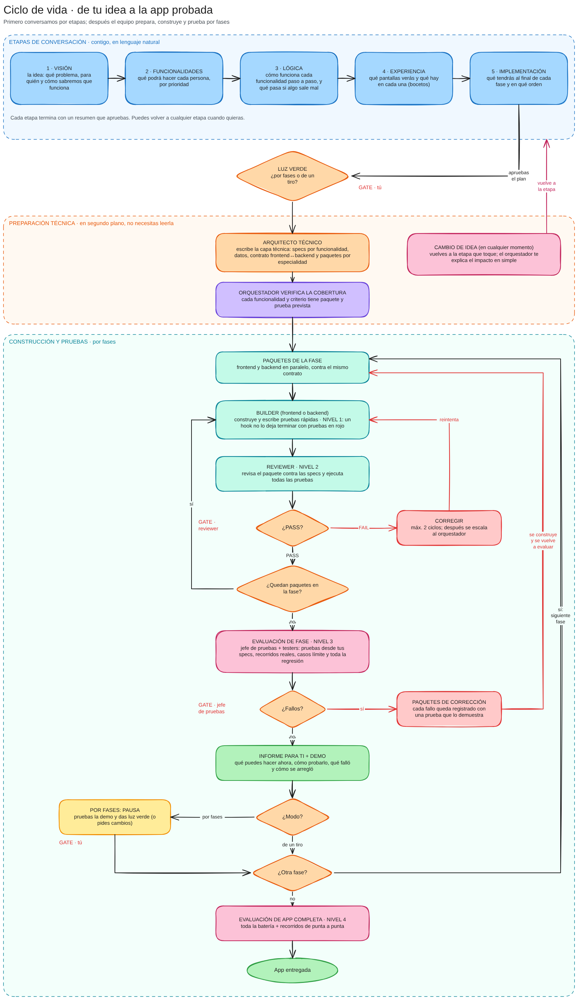
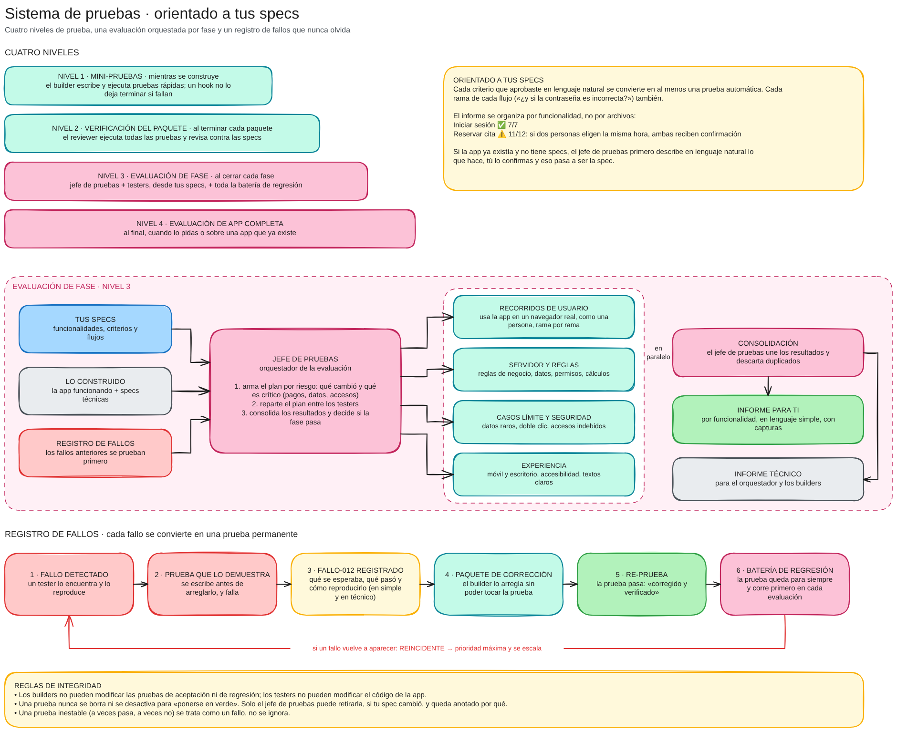
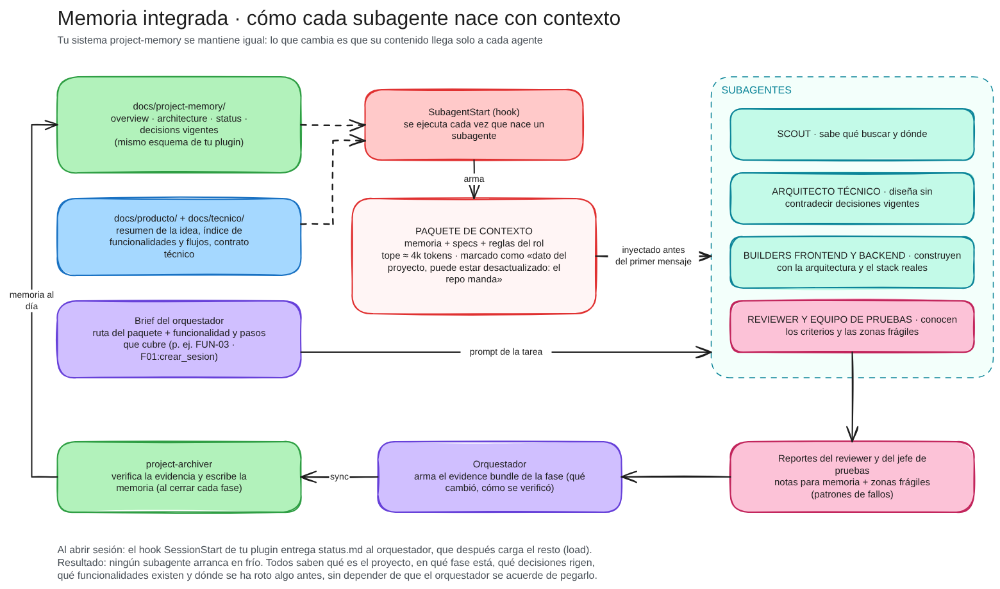

# Visión del sistema de agentes · concepto v1

> **Estado:** concepto para discutir. Todavía no hay nada implementado. Esta versión incorpora tus comentarios sobre la v0 (sección 2). Al final están las decisiones que necesito de ti (sección 16).

Este documento es el mapa general. Dos temas tienen su propio documento:

- **[Conversación por etapas](ETAPAS-DE-CONVERSACION.md):** cómo te habla el orquestador, qué ves y qué decides en cada etapa, y los modos de construcción.
- **[Sistema de pruebas](SISTEMA-DE-PRUEBAS.md):** los cuatro niveles de prueba, el jefe de pruebas con sus testers y el registro de fallos.

Diagramas (ábrelos en [excalidraw.com](https://excalidraw.com) con *Open*, o con la extensión de Excalidraw de VS Code; cada uno tiene su vista previa `.png` al lado):

| Diagrama | Qué explica |
| --- | --- |
| [`01-arquitectura`](diagramas/01-arquitectura.png) | Quién habla con quién, quién escribe qué y qué reglas se cumplen solas |
| [`02-ciclo-de-vida`](diagramas/02-ciclo-de-vida.png) | De tu idea a la app probada: etapas, preparación técnica, construcción y pruebas por fases |
| [`03-memoria-y-contexto`](diagramas/03-memoria-y-contexto.png) | Cómo tu `project-memory` llega a cada agente y cómo se actualiza |
| [`04-anatomia-de-una-funcionalidad`](diagramas/04-anatomia-de-una-funcionalidad.png) | Lo que lees tú (lenguaje natural) frente a lo que leen los agentes (técnico) |
| [`05-etapas-de-conversacion`](diagramas/05-etapas-de-conversacion.png) | Las cinco etapas de la conversación y los modos de construcción |
| [`06-sistema-de-pruebas`](diagramas/06-sistema-de-pruebas.png) | Niveles de prueba, evaluación orquestada y registro de fallos |

---

## 1. En una frase

Tú le cuentas al **orquestador**, en tus palabras, qué app quieres. Él te acompaña por **cinco etapas** para que veas la visión, las funcionalidades, la lógica, las pantallas y el plan antes de construir nada. Después, un **equipo técnico** traduce todo eso a documentación técnica, **builders especializados** (frontend y backend) lo construyen por fases, y un **equipo de pruebas** evalúa cada fase contra lo que tú pediste. Todos trabajan con la **memoria del proyecto**, y tú recibes los resultados en lenguaje simple.



---

## 2. Qué cambió respecto a la v0

| Pediste | Cómo queda en la v1 |
| --- | --- |
| El orquestador debe conversar con alguien que no programa | Habla sin jerga, pregunta por consecuencias y no por tecnologías, y te muestra resultados en tus términos. Las decisiones técnicas las toma el equipo técnico ([reglas de conversación](ETAPAS-DE-CONVERSACION.md#2-cómo-te-habla-el-orquestador)) |
| Specs en lenguaje natural ("crea un sistema de login") | **Dos capas de documentación:** la tuya (`docs/producto/`) solo en lenguaje natural, y la técnica (`docs/tecnico/`) en segundo plano para los agentes. Cada pieza técnica apunta a tu funcionalidad (sección 5) |
| Conversación por etapas para ver visión, lógica, implementación y funcionalidades antes de delegar | **Cinco etapas** (visión, funcionalidades, lógica, experiencia e implementación), cada una con algo que ves y algo que decides. Nada se delega hasta tu luz verde |
| Elegir si se construye por fases o de un tiro | **Tres modos:** por fases, de un tiro o hasta la fase N. Puedes cambiar de modo en cualquier momento |
| Dividir al programador en especialistas | **Builder frontend** y **builder backend**, coordinados por un **contrato** que define el arquitecto técnico. Más especialistas opcionales (móvil, integraciones, despliegue) |
| Un sistema de pruebas robusto y orientado a specs | **Cuatro niveles de prueba**, un **jefe de pruebas** que orquesta a **cuatro testers** especializados, y un **registro de fallos** donde cada fallo queda como prueba permanente ([sistema de pruebas](SISTEMA-DE-PRUEBAS.md)) |
| Poder probar una app ya hecha | **Modo auditoría:** el equipo de pruebas describe lo que hace la app, tú lo confirmas y se evalúa entera |

---

## 3. Principios de diseño

1. **Una sola voz.** Hablas con un único agente. Los demás nunca te piden nada directamente.
2. **Tú decides qué; el equipo decide cómo.** Tú defines qué hace la app y cómo se siente. Las tecnologías y la estructura del código las decide el equipo técnico. Solo te consulta cuando una decisión técnica te afecta: costo, plataformas, privacidad o tiempos.
3. **Ver antes de construir.** Nada se construye hasta que viste y aprobaste la funcionalidad, su lógica y sus pantallas.
4. **Dos capas, una verdad.** Tu documentación y la técnica describen lo mismo con distinto lenguaje. Cada pieza técnica apunta a una funcionalidad tuya por su id.
5. **Nadie se califica a sí mismo.** Los builders construyen, el reviewer revisa cada paquete y el equipo de pruebas evalúa cada fase.
6. **Nada se olvida.** Cada fallo encontrado se convierte en una prueba que se ejecuta para siempre.
7. **Tareas pequeñas y verificables.** El trabajo se parte en paquetes pequeños, uno por especialidad.
8. **La memoria es evidencia.** Se escribe solo con lo verificado y al cerrar cada fase, siempre a través de tu `project-archiver`.
9. **Lo crítico se garantiza con código.** Las reglas importantes las hacen cumplir hooks, no un "por favor" en el prompt.

---

## 4. El equipo

| Rol | Qué hace | Escribe en | Modelo propuesto |
| --- | --- | --- | --- |
| **Orquestador** (hilo principal) | Conversa contigo por etapas, escribe tu capa de producto, traduce, delega, hace cumplir los gates y te reporta en lenguaje simple | `docs/producto/**` y el estado del tablero | `opus` |
| **Scout** | Lee el código existente y responde preguntas concretas | Nada | `haiku` |
| **Arquitecto técnico** | Traduce tu capa de producto a la capa técnica: tecnologías, datos, **contrato frontend↔backend**, spec técnica por funcionalidad y paquetes de trabajo por especialidad | `docs/tecnico/**` | `opus` |
| **Builder frontend** | Pantallas, navegación, formularios, estilos: lo que ves y tocas. Habla con el backend solo a través del contrato | Código de frontend + sus pruebas rápidas | `sonnet` |
| **Builder backend** | Servidor, datos, reglas de negocio, permisos, pagos, correos | Código de backend + sus pruebas rápidas | `sonnet` |
| **Reviewer** | Revisa cada paquete: ejecuta todas las pruebas, contrasta con la spec técnica y con tu funcionalidad, vigila el alcance. PASS o FAIL | Nada | `opus` |
| **Jefe de pruebas** | Orquesta la evaluación de cada fase: arma el plan desde tus specs, lo reparte entre los testers, consolida y decide. Lleva el registro de fallos | `docs/pruebas/**` | `opus` |
| **Testers ×4** | Recorridos de usuario en navegador real · servidor y reglas · casos límite y seguridad · experiencia (móvil, accesibilidad, textos) | Pruebas automáticas (`tests/aceptacion`, `tests/e2e`, `tests/regresion`) | `sonnet` |
| **Project-archiver** (tu agente, sin cambios) | `init`, `sync` y `archive` de la memoria | `docs/project-memory/**` | `sonnet` |

**Especialistas opcionales**, que el arquitecto técnico propone solo si el proyecto los necesita: **móvil** (app nativa), **integraciones** (pagos, mensajería, servicios externos complejos) y **despliegue** (publicar la app en internet).

### Por qué frontend y backend separados, y cómo se coordinan

- **Contexto más limpio:** cada builder recibe solo las convenciones, archivos y reglas de su lado. Esto reduce errores.
- **Paralelismo natural:** el frontend y el backend de una misma funcionalidad tocan archivos distintos, así que pueden construirse a la vez.
- **El contrato es el punto de encuentro:** antes de construir, el arquitecto técnico escribe en `docs/tecnico/contrato-api.md` qué datos se piden y se devuelven en cada operación. El frontend construye contra ese contrato y el backend lo cumple. Si uno de los dos necesita cambiarlo, se detiene y lo reporta (`CONTRACT GAP`); el arquitecto ajusta el contrato y los dos siguen. Ninguno lo cambia por su cuenta.

### Por qué el orquestador es el hilo principal

Solo el agente principal de la sesión conversa contigo. Claude Code permite que ese agente principal sea uno personalizado, con `claude --agent` o con un `settings.json` dentro del plugin que lo activa por defecto. Lo verifiqué en la documentación actual.

### La única excepción a la jerarquía plana: el jefe de pruebas

Por defecto, ningún subagente puede delegar (así se evita el teléfono descompuesto). La excepción es el jefe de pruebas, que lanza a sus testers. Claude Code permite que un subagente lance otros subagentes (hasta tres niveles por debajo de la conversación principal; también lo verifiqué). Un hook garantiza que el jefe de pruebas **solo** pueda lanzar testers y que los testers no puedan lanzar a nadie.

---

## 5. Dos capas de documentación



| | Capa de producto (la tuya) | Capa técnica (la de los agentes) |
| --- | --- | --- |
| Lenguaje | Natural, sin jerga | Técnico |
| La escribe | El orquestador, contigo | El arquitecto técnico |
| Ejemplo | "Tus clientes entran con su correo y su contraseña. Si se equivocan 5 veces seguidas, la cuenta se pausa 15 minutos." | "Comparación con la contraseña cifrada, contador de intentos, pausa de 15 min, sesión segura de 7 días." |
| ¿La necesitas leer? | Sí, es tuya | No. Si quieres, el orquestador te la explica |

```text
docs/
  producto/                     TU CAPA · la escribe el orquestador
    1-idea.md                     problema, para quién, cómo sabremos que funciona
    2-funcionalidades.md          catálogo FUN-01, FUN-02… con prioridad
    3-logica/                     una ficha por funcionalidad + sus flujos
      FUN-03-iniciar-sesion.md
      F01-iniciar-sesion.flow.json   fuente del flujo
      F01-iniciar-sesion.md          generado: diagrama Mermaid + pasos
      F01-iniciar-sesion.excalidraw  generado: mapa visual
    4-experiencia/                pantallas y bocetos
    5-plan-de-fases.md            qué tendrás al final de cada fase
    glosario.md                   los pocos términos técnicos inevitables, explicados
  tecnico/                      CAPA TÉCNICA · la escribe el arquitecto técnico
    arquitectura.md · datos.md · contrato-api.md
    specs/FUN-03-iniciar-sesion.md
    trabajo/PLAN.md · trabajo/WP-007.md …
  pruebas/                      CAPA DE PRUEBAS · la escribe el jefe de pruebas
    matriz-de-cobertura.md · planes/ · registro-de-fallos.md · informes/
  project-memory/               TU SISTEMA · lo escribe el project-archiver
tests/
  unit/ (builders) · aceptacion/ · e2e/ · regresion/ (equipo de pruebas)
```

**Trazabilidad.** Todo se conecta por ids, de tu frase a tu informe. `FUN-03` es tu funcionalidad; `F01:crear_sesion` es un paso de su flujo; `WP-007` es un paquete que lo implementa; la prueba de aceptación cita el criterio que verifica. Por eso el informe final puede decirte "Iniciar sesión ✅ 7/7" y no "auth.test.ts passed".

### Los flujos: lógica visible

En la etapa 3, el orquestador dibuja cada funcionalidad como un **diagrama de flujo con tus palabras**: "¿La contraseña coincide?", no "bcrypt.compare()". Mantiene lo que la v0 ya proponía:

- **La fuente es un archivo de datos** (`.flow.json`) y un generador produce las vistas: un `.md` con Mermaid para leer y un `.excalidraw` para ver. El orquestador no dibuja coordenadas (ahí los modelos fallan); describe pasos y ramas.
- **Un validador** revisa cada flujo al guardarlo: todo paso alcanzable, todo camino con final, toda decisión con sus ramas etiquetadas y todo fallo posible con su salida.
- **Estados y versiones:** borrador, en revisión, aprobado. Cambiar uno aprobado sube su versión y marca el trabajo afectado.

Cada paso del flujo tiene su ficha en lenguaje natural: qué pasa, qué ve la persona, qué reglas aplican y qué pasa si algo sale mal. Los detalles técnicos de cada paso viven en la capa técnica, enlazados por el id del paso.

---

## 6. Cómo trabajas tú

Tu trabajo es **contar, ver, decidir y probar**. El detalle está en **[Conversación por etapas](ETAPAS-DE-CONVERSACION.md)**.



| Etapa | Ves | Decides |
| --- | --- | --- |
| 1 · Visión | La ficha de la idea y un mapa de personas | Si la idea quedó bien contada |
| 2 · Funcionalidades | El catálogo, con prioridades | Qué entra en la primera versión |
| 3 · Lógica | Un diagrama de flujo por funcionalidad | Aprobar cada flujo |
| 4 · Experiencia | Bocetos de las pantallas | Si se siente como la imaginas |
| 5 · Implementación | Las fases: "Fase 1: ya podrás…" | Luz verde y el modo |

**Modos de construcción:**

| Modo | Qué pasa |
| --- | --- |
| **Por fases** | Al terminar cada fase se detiene, te muestra la demo y el informe de pruebas, y espera tu luz verde |
| **De un tiro** | Construye todas las fases seguidas, con sus pruebas. Solo te interrumpe si hay una pregunta que solo tú puedes responder |
| **Hasta la fase N** | De un tiro hasta donde digas, y ahí te muestra |

En cualquier momento puedes decir "para aquí", "sigue de un tiro" o "¿cómo vamos?".

---

## 7. Ciclo de vida



| Bloque | Quién | Resultado | Gate |
| --- | --- | --- | --- |
| Etapas 1–5 | Orquestador ↔ tú | Tu capa de producto completa y aprobada. Sync de memoria (una spec aprobada es un hito para tu skill) | Tú: luz verde y modo |
| Preparación técnica | Arquitecto técnico → orquestador | Capa técnica + paquetes. El orquestador comprueba que cada funcionalidad y cada criterio tienen paquete y prueba prevista, y te da un resumen de 5 líneas | Cobertura completa |
| Construcción (por paquete) | Builder frontend o backend → reviewer | Código + pruebas rápidas (nivel 1) + revisión (nivel 2) | Reviewer: PASS |
| Evaluación de fase | Jefe de pruebas + testers | Informe por funcionalidad + registro de fallos al día (nivel 3) | Jefe de pruebas: la fase pasa |
| Cierre de fase | Orquestador → archiver | Memoria sincronizada, informe y demo para ti | Tú (en modo por fases) |
| Final | Jefe de pruebas + testers | Evaluación de la app completa (nivel 4) | Entrega |

**Bucles:** un FAIL del reviewer vuelve al mismo builder (máximo 2 ciclos; después se escala). Cada fallo de la evaluación de fase se convierte en un paquete de corrección y en una prueba de regresión, y se vuelve a evaluar. Un cambio de idea te devuelve a la etapa que corresponda, y el orquestador te explica antes el impacto en simple.

---

## 8. Disciplina de cargas de trabajo

### 8.1 Fases

Una **fase** es un conjunto de paquetes que termina en algo que **puedes probar**. La fase 1 siempre incluye el esqueleto (la app arranca, las pruebas corren) y al menos una funcionalidad completa de punta a punta. Cada fase añade funcionalidades completas, con su frontend y su backend; no se construyen capas sueltas como "todo el backend primero".

### 8.2 El paquete de trabajo (WP)

Lo escribe el arquitecto técnico. Cada paquete es de **una sola especialidad**:

```markdown
# WP-008: Inicio de sesión · backend
- Especialidad: backend
- Fase: 1
- Funcionalidad: FUN-03 Iniciar sesión
- Cubre: F01:password_ok, F01:limite, F01:crear_sesion (incluye ramas de error)
- Contrato: docs/tecnico/contrato-api.md#sesiones
- Depende de: WP-002 (datos de usuarios)
- En paralelo con: WP-007 (frontend de la misma funcionalidad)
- Tamaño: M
- Archivos en alcance: …
## Objetivo
## Criterios técnicos de aceptación (cada uno ligado a un criterio de FUN-03 o a un paso)
## Verificación (comando)
## Fuera de alcance
```

### 8.3 Límites

| Regla | Valor propuesto |
| --- | --- |
| Tamaño de paquete | **S:** ≤3 archivos, ~150 líneas · **M:** ≤8 archivos, ~400 líneas · **L: prohibido**, se divide |
| Builders a la vez | **2** (un frontend y un backend, en archivos distintos). Más, con espacios de trabajo aislados en una versión posterior |
| Ciclos de corrección por paquete | Máx. **2**; después se escala al orquestador |
| Preguntas por ronda en la conversación | 2–4, con opciones y recomendación |

### 8.4 Definición de terminado (paquete)

1. Las pruebas rápidas del builder pasan (nivel 1, garantizado por hook).
2. El reviewer ejecutó **todas** las pruebas del proyecto y pasan (nivel 2).
3. Cada criterio técnico tiene evidencia, incluidas las ramas de error.
4. No hay cambios fuera del alcance sin justificar, y no se tocaron pruebas de aceptación ni de regresión.
5. Sin pruebas desactivadas, sin `TODO` que oculten funcionalidad pendiente y sin secretos en el código.
6. Commit hecho y tablero actualizado.

Una **fase** está terminada cuando además pasa la evaluación de fase (nivel 3) del jefe de pruebas.

### 8.5 Protocolos de parada: nadie improvisa

| Señal | Cuándo | Qué pasa |
| --- | --- | --- |
| `PRODUCT GAP` | La spec no responde algo que afecta a lo que ves o vives como usuario | El orquestador te lo pregunta en simple, actualiza tu capa y el trabajo sigue |
| `CONTRACT GAP` | El frontend o el backend necesita cambiar el contrato | El arquitecto ajusta el contrato; los dos builders siguen |
| `SCOPE GAP` | Hay que tocar archivos fuera del alcance de forma importante | El arquitecto replanifica el paquete |
| `BLOCKED` | Falla algo ajeno al paquete | Se resuelve en otro paquete o se escala |

Las dudas técnicas menores las resuelve el builder con la opción conservadora y las declara como supuesto en su reporte. Las dudas de producto nunca: esas siempre llegan a ti.

### 8.6 Higiene de contexto

- El orquestador no lee código ni logs. Pregunta al scout o lee los reportes.
- Cada encargo es un brief autocontenido. El resto del contexto lo inyecta un hook.
- Los subagentes devuelven reportes estructurados y cortos, nunca transcripciones.

### 8.7 Git

Una rama por fase y un commit por paquete aprobado. Los builders nunca hacen commit. `push` y publicación solo cuando tú lo pidas.

---

## 9. Sistema de pruebas (resumen)



| Nivel | Cuándo | Quién | Garantía |
| --- | --- | --- | --- |
| 1 · Mini-pruebas | Mientras se construye | Builder | Un hook no deja terminar al builder con pruebas en rojo |
| 2 · Verificación del paquete | Al terminar cada paquete | Reviewer | Ejecuta todas las pruebas y revisa contra las specs |
| 3 · Evaluación de fase | Al cerrar cada fase | Jefe de pruebas + 4 testers | Pruebas desde tus specs + recorridos reales + toda la regresión |
| 4 · Evaluación de app completa | Al final, a pedido o sobre una app ya hecha | Igual, a escala de toda la app | Informe completo por funcionalidad |

Cada fallo se reproduce con una **prueba automática antes de arreglarlo**, se registra en lenguaje simple y técnico (`FALLO-012`) y la prueba queda **para siempre** en la batería de regresión, que se ejecuta primero en cada evaluación. Si un fallo vuelve, se marca como **reincidente** y se escala. Todo el detalle está en **[Sistema de pruebas](SISTEMA-DE-PRUEBAS.md)**.

---

## 10. Memoria integrada (tu `project-memory`)



Tu sistema se integra **tal cual**: mismo esquema, mismo `archive.js`, mismo `project-archiver` con su guard. Así sigue siendo compatible con la versión de OpenCode.

| Momento | Qué pasa | Mecanismo |
| --- | --- | --- |
| Abres una sesión | El orquestador recibe `status.md` y carga el resto (`load`) | Tu hook `session-start` + instrucción del orquestador |
| Nace cualquier subagente | Recibe un paquete de contexto: memoria vigente, resumen de la idea, índice de funcionalidades y flujos, contrato técnico y reglas de su rol. A los testers, además, las **zonas frágiles** | Hook `SubagentStart` (verificado en la doc de Claude Code) |
| Se aprueba tu capa de producto | `sync`: tu skill trata una spec aprobada como hito | Orquestador → `project-archiver` |
| Se cierra una fase | `sync` con la evidencia: qué se construyó, cómo se probó y patrones de fallos | Orquestador → `project-archiver` |
| `sessions.md` pasa de 10 entradas | Archivo sin pérdidas | Tu `archive.js` |

El paquete inyectado tiene un **tope de tamaño** (~4k tokens), va **marcado como dato y no como instrucción** ("puede estar desactualizado: el repo manda") y no incluye historia (`sessions.md`, `archive/`).

**La memoria y las specs no se pisan:** la memoria dice qué es verdad hoy (estado, arquitectura real, decisiones vigentes, zonas frágiles); las specs dicen qué debe hacer la app. La memoria enlaza a las specs y no copia su contenido.

---

## 11. Reglas que se cumplen solas (hooks)

Los agentes empaquetados en un plugin no pueden traer sus propios hooks; Claude Code los ignora por seguridad. Por eso las reglas viven en el `hooks.json` del plugin y reconocen a cada agente por el campo `agent_type`, igual que tu `archiver-guard`.

| Hook | Evento | Qué garantiza |
| --- | --- | --- |
| **Guardia de roles** | `PreToolUse` | Cada rol escribe solo en su zona (sección 12). Los builders no pueden tocar pruebas de aceptación ni de regresión, ni el contrato. Los testers no pueden tocar el código de la app. El orquestador solo delega en el equipo; el jefe de pruebas, solo en testers; nadie más delega |
| **Inyección de contexto** | `SubagentStart` | Todo subagente nace con memoria + specs + reglas de su rol |
| **Pruebas rápidas obligatorias** | `SubagentStop` (builders) | Al intentar terminar, el hook ejecuta las pruebas rápidas; si fallan, el builder sigue trabajando (nivel 1) |
| **Control de reporte** | `SubagentStop` | Builder, reviewer, arquitecto y jefe de pruebas no terminan sin su bloque de reporte. Un informe de fase sin resultados de regresión es devuelto |
| **Generador de flujos** | `PostToolUse` | Al guardar un flujo: valida, genera el `.md` y el `.excalidraw` y devuelve los errores al orquestador |
| **Recordatorio de gate** | `PostToolUse` sobre la delegación | Recuerda al orquestador que un paquete no está hecho sin el PASS del reviewer, ni una fase sin la evaluación del jefe de pruebas |
| **Arranque** | `SessionStart` | Tu hook de memoria + el estado de las etapas y del tablero |

---

## 12. Quién escribe dónde

| Ruta | Escribe | Lee |
| --- | --- | --- |
| `docs/producto/**` | Solo el orquestador (los diagramas los genera el hook) | Todos |
| `docs/tecnico/**` | Solo el arquitecto técnico (el orquestador solo cambia el estado del tablero) | Todos |
| `docs/pruebas/**`, `tests/aceptacion`, `tests/e2e`, `tests/regresion` | Solo el jefe de pruebas y los testers | Todos |
| Código de frontend + sus pruebas rápidas | Builder frontend, dentro del alcance de su paquete | Reviewer, testers, scout |
| Código de backend + sus pruebas rápidas | Builder backend, dentro del alcance de su paquete | Reviewer, testers, scout |
| `docs/project-memory/**` | Solo el `project-archiver` | Todos (inyectada) |

---

## 13. Cómo se empaquetaría

Este repo sería un **marketplace de plugins de Claude Code** con tres plugins:

```text
System-agents/
  .claude-plugin/marketplace.json
  plugins/
    project-memory/   tu plugin, sin cambios
    pruebas/          jefe de pruebas + testers + registro de fallos; usable solo, sobre cualquier app
    orquesta/         orquestador, scout, arquitecto, builders y reviewer + flujos + hooks
                      depende de project-memory y de pruebas
```

- `orquesta` declara a los otros dos como **dependencias**: al instalarlo, la memoria y las pruebas vienen integradas por defecto.
- `pruebas` funciona también **solo**, para auditar una app que ya existe aunque no se haya hecho con este sistema.
- El `settings.json` de `orquesta` convierte al orquestador en el agente principal de la sesión, así que conviene instalarlo **por proyecto**.

---

## 14. Cómo verás los resultados

Una persona que no programa no debería tener que ejecutar comandos para ver su app. Propongo tres formas, combinables (decisión 9):

| Forma | Qué es | Requisito |
| --- | --- | --- |
| **Capturas y video** | El tester de recorridos usa la app en un navegador real; las capturas y un video corto de cada recorrido van en tu informe | Ninguno |
| **Enlace de prueba** | La app publicada en una dirección privada para que la uses desde tu móvil u ordenador | Configurar el alojamiento: lo haría el especialista de despliegue, con tu aprobación del costo |
| **Guía para probar** | "Entra, pulsa Reservar, elige mañana a las 10…": qué hacer para comprobar cada funcionalidad nueva | Viene con cualquiera de las anteriores |

---

## 15. Límites honestos y riesgos

| Límite | Mitigación |
| --- | --- |
| La guardia depende de que Claude Code envíe `agent_type` a los hooks (lo hace en subagentes y con `--agent`) | Las instrucciones repiten los límites; el reviewer revisa qué archivos cambiaron |
| Por la terminal (`Bash`), un agente podría escribir donde no debe; no se puede blindar cada comando | La guardia bloquea los casos obvios y el reviewer y el jefe de pruebas detectan el resto |
| Las pruebas de seguridad son básicas (accesos indebidos, datos maliciosos), no una auditoría profesional | Se dice así en el informe; si la app maneja pagos o datos sensibles, se recomienda una revisión externa |
| Estimar tiempos con IA es poco fiable | Las fases se describen por lo que entregan y su tamaño relativo, no en horas |
| Más agentes y modelos `opus` cuestan más | Modo económico (decisión 4) y evaluaciones de fase centradas en lo que cambió y lo crítico |
| El paralelismo puede generar conflictos | Solo frontend y backend a la vez, en archivos distintos, contra un contrato fijo |
| Una spec aprobada puede estar equivocada | La demo de cada fase y los cambios de idea existen para eso |
| Los hooks necesitan `node` | Igual que tu plugin actual: si falta, fallan abiertos y avisan |

---

## 16. Decisiones que necesito de ti

Cada una trae mi recomendación. Si estás de acuerdo con todas, basta con "de acuerdo con las recomendaciones".

| # | Decisión | Opciones | Recomiendo |
| --- | --- | --- | --- |
| 1 | ¿Quién hace los commits? | (a) el orquestador, uno por paquete aprobado · (b) tú | **(a)**, y publicar solo cuando lo pidas |
| 2 | Paralelismo | (a) frontend + backend a la vez · (b) uno a la vez | **(a)** |
| 3 | Especialistas | (a) frontend y backend fijos, más opcionales (móvil, integraciones, despliegue) cuando haga falta · (b) solo frontend y backend | **(a)** |
| 4 | Modelos | (a) calidad: los que piensan y juzgan en `opus`, los que construyen y prueban en `sonnet` · (b) económico: solo el orquestador en `opus` | **(a)**; (b) para proyectos pequeños |
| 5 | Tecnologías | (a) un "stack de la casa" que el equipo usa siempre salvo que algo lo impida · (b) el arquitecto elige en cada proyecto | **(a)**: más predecible y mejor probado; tú no tienes que elegirlo |
| 6 | Etapa 4 (bocetos de pantallas) | (a) siempre · (b) opcional en apps pequeñas | **(a)**, en versión ligera para apps pequeñas |
| 7 | Evaluación de fase en modo "de un tiro" | (a) se corrige sola y solo te interrumpe si un fallo requiere una decisión tuya · (b) se detiene ante cualquier fallo | **(a)** |
| 8 | Granularidad de aprobación en la etapa 3 | (a) apruebas cada flujo · (b) todos juntos | **(a)** al principio |
| 9 | Cómo ver los resultados | (a) capturas y video · (b) enlace de prueba · (c) ambas | **(c)**: capturas y video desde la fase 1, enlace cuando se configure el alojamiento |
| 10 | Empaquetado | (a) tres plugins (`project-memory`, `pruebas`, `orquesta`) · (b) uno solo | **(a)**: tu plugin queda intacto y las pruebas sirven para cualquier app |
| 11 | Idioma | (a) instrucciones internas de los agentes en inglés; todo lo que tú ves, en español · (b) todo en español | **(a)** |
| 12 | Activación | (a) por proyecto · (b) en todas tus sesiones | **(a)** |

---

## 17. Próximos pasos

1. **Tú:** revisas este documento, los dos documentos de detalle y los seis diagramas; respondes las decisiones o las cambias.
2. **Yo:** ajusto el concepto.
3. Construimos el sistema **con su propio método**: este concepto hace de etapas 1 a 3, y después vienen el plan por fases y la construcción:
   - **Fase 1 · Núcleo:** orquestador con etapas y lenguaje natural, arquitecto técnico, builders frontend y backend, reviewer, inyección de memoria, contratos de reporte.
   - **Fase 2 · Flujos:** fichas de funcionalidad, validador y generadores Mermaid y Excalidraw (flujos, mapas y bocetos).
   - **Fase 3 · Pruebas:** plugin `pruebas` con jefe de pruebas, testers, registro de fallos y modo auditoría.
   - **Fase 4 · Guardias y escala:** propiedad por rol, pruebas obligatorias por hook, especialistas opcionales y espacios de trabajo aislados.
