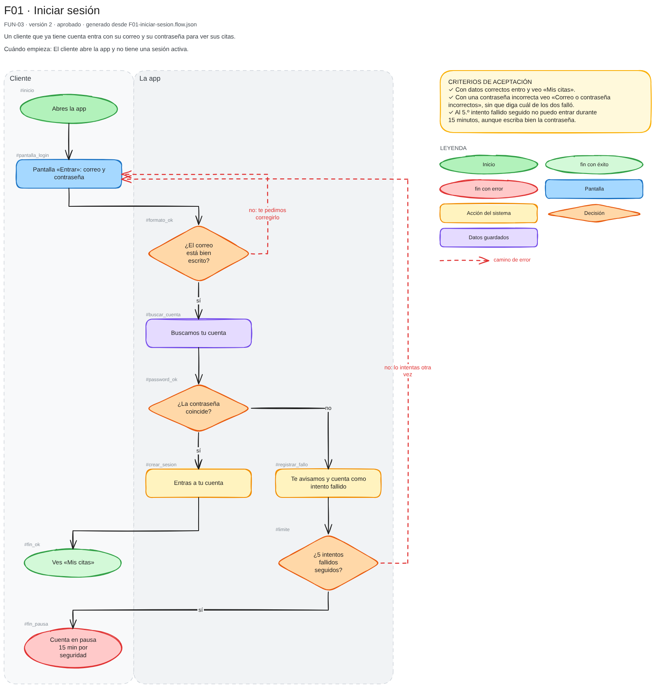

# Ejemplo · Barbería Navaja

Así queda la capa de producto (`docs/producto/`) que el orquestador escribe contigo durante las cinco etapas. Los `.json` son las fuentes que escribe el orquestador; el sistema genera los `.md` de los flujos y todos los `.excalidraw`.

| Etapa | Archivos | Vista previa |
| --- | --- | --- |
| 1 · Visión | [`1-idea.md`](docs/producto/1-idea.md) · [`1-personas.excalidraw`](docs/producto/1-personas.excalidraw) | [personas](vistas-previas/1-personas.png) |
| 2 · Funcionalidades | [`2-funcionalidades.md`](docs/producto/2-funcionalidades.md) · [`2-funcionalidades.excalidraw`](docs/producto/2-funcionalidades.excalidraw) | [mapa](vistas-previas/2-funcionalidades.png) |
| 3 · Lógica | [`FUN-03-iniciar-sesion.md`](docs/producto/3-logica/FUN-03-iniciar-sesion.md) · [`F01-iniciar-sesion.md`](docs/producto/3-logica/F01-iniciar-sesion.md) (Mermaid + paso a paso) · [`F01-iniciar-sesion.excalidraw`](docs/producto/3-logica/F01-iniciar-sesion.excalidraw) | [flujo](vistas-previas/F01-iniciar-sesion.png) |
| 4 · Experiencia | [`reservar.excalidraw`](docs/producto/4-experiencia/reservar.excalidraw) | [bocetos](vistas-previas/reservar.png) |
| 5 · Implementación | [`5-plan-de-fases.excalidraw`](docs/producto/5-plan-de-fases.excalidraw) | [fases](vistas-previas/5-plan-de-fases.png) |

Para regenerar las vistas:

```text
node plugins/orquesta/skills/producto/scripts/diagramas.js todo ejemplos/barberia
```


