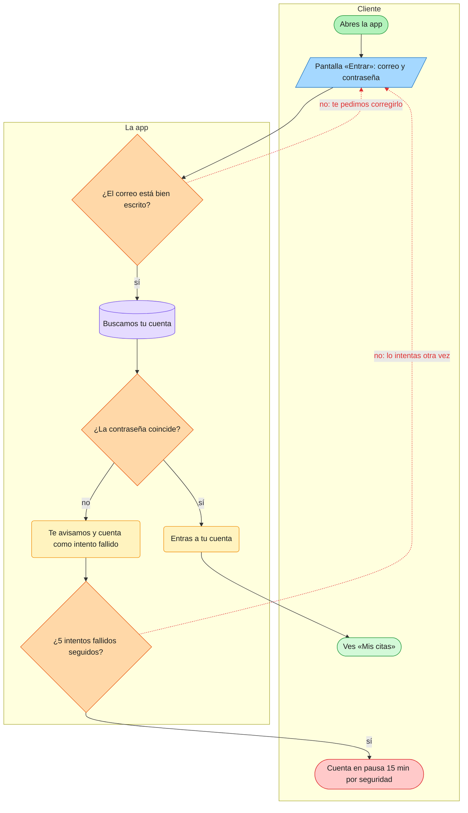

<!-- Generado por orquesta desde F01-iniciar-sesion.flow.json. No lo edites a mano: edita el .flow.json y se regenera. -->
# F01 · Iniciar sesión

| Funcionalidad | Versión | Estado | Actores |
| --- | --- | --- | --- |
| FUN-03 | 2 | aprobado | Cliente, La app |

Un cliente que ya tiene cuenta entra con su correo y su contraseña para ver sus citas.

**Cuándo empieza:** El cliente abre la app y no tiene una sesión activa.

**Antes de empezar:**

- El cliente ya se registró (FUN-01).

**Al terminar:**

- El cliente ve «Mis citas» y su sesión dura 7 días en ese dispositivo.

## Diagrama

Mapa visual editable: [F01-iniciar-sesion.excalidraw](F01-iniciar-sesion.excalidraw)

## Paso a paso

### 1. Abres la app · `F01:inicio`

*Inicio* · Actor: Cliente

- **Siguiente:** `pantalla_login`

### 2. Pantalla «Entrar»: correo y contraseña · `F01:pantalla_login`

*Pantalla* · Actor: Cliente

La persona escribe su correo y su contraseña y pulsa «Entrar».

- **Lo que ve la persona:** Dos campos (correo y contraseña), el botón «Entrar» y el enlace «¿Olvidaste tu contraseña?».
- **Siguiente:** `formato_ok`

### 3. ¿El correo está bien escrito? · `F01:formato_ok`

*Decisión* · Actor: La app

Antes de buscar la cuenta se comprueba que el correo tenga forma de correo.

- **Reglas:** Se ignoran los espacios al principio y al final · No importan mayúsculas o minúsculas
- **Siguiente:** `buscar_cuenta` (sí) · `pantalla_login` (no: te pedimos corregirlo) ⚠

### 4. Buscamos tu cuenta · `F01:buscar_cuenta`

*Datos guardados* · Actor: La app

Se busca la cuenta que tenga ese correo.

- **Información que usa o guarda:** Cuenta del cliente (consulta)
- **Siguiente:** `password_ok`

### 5. ¿La contraseña coincide? · `F01:password_ok`

*Decisión* · Actor: La app

Se compara la contraseña escrita con la guardada. Si no existe una cuenta con ese correo, se responde igual que con una contraseña incorrecta.

- **Reglas:** Nunca se dice cuál de los dos datos falló
- **Siguiente:** `crear_sesion` (sí) · `registrar_fallo` (no)

### 6. Entras a tu cuenta · `F01:crear_sesion`

*Acción del sistema* · Actor: La app

Se crea una sesión que dura 7 días en ese dispositivo y se pone a cero el contador de intentos.

- **Reglas:** R-02: la sesión dura 7 días · R-05: se permiten varias sesiones por cliente
- **Información que usa o guarda:** Sesión (crear) · Último acceso del cliente (actualizar)
- **Si algo sale mal:** Si no se puede guardar la sesión, se muestra «Inténtalo de nuevo» y no se entra
- **Siguiente:** `fin_ok`

### 7. Te avisamos y cuenta como intento fallido · `F01:registrar_fallo`

*Acción del sistema* · Actor: La app

Se suma un intento fallido a la cuenta y se muestra el aviso.

- **Lo que ve la persona:** «Correo o contraseña incorrectos»
- **Información que usa o guarda:** Intentos fallidos de la cuenta (actualizar)
- **Siguiente:** `limite`

### 8. Ves «Mis citas» · `F01:fin_ok`

*fin con éxito* · Actor: Cliente

### 9. ¿5 intentos fallidos seguidos? · `F01:limite`

*Decisión* · Actor: La app

Se mira cuántos intentos fallidos seguidos lleva la cuenta.

- **Reglas:** El contador vuelve a cero al entrar con éxito
- **Siguiente:** `fin_pausa` (sí) · `pantalla_login` (no: lo intentas otra vez) ⚠

### 10. Cuenta en pausa 15 min por seguridad · `F01:fin_pausa`

*fin con error* · Actor: Cliente

## Transiciones

| De | A | Condición | Tipo |
| --- | --- | --- | --- |
| `inicio` | `pantalla_login` | — | normal |
| `pantalla_login` | `formato_ok` | — | normal |
| `formato_ok` | `buscar_cuenta` | sí | normal |
| `formato_ok` | `pantalla_login` | no: te pedimos corregirlo | error |
| `buscar_cuenta` | `password_ok` | — | normal |
| `password_ok` | `crear_sesion` | sí | normal |
| `password_ok` | `registrar_fallo` | no | normal |
| `registrar_fallo` | `limite` | — | normal |
| `limite` | `fin_pausa` | sí | normal |
| `limite` | `pantalla_login` | no: lo intentas otra vez | error |
| `crear_sesion` | `fin_ok` | — | normal |

## Criterios de aceptación

- [ ] **CA1.** Con datos correctos entro y veo «Mis citas».
- [ ] **CA2.** Con una contraseña incorrecta veo «Correo o contraseña incorrectos», sin que diga cuál de los dos falló.
- [ ] **CA3.** Al 5.º intento fallido seguido no puedo entrar durante 15 minutos, aunque escriba bien la contraseña.

## Historial de cambios

| Versión | Fecha | Cambio |
| --- | --- | --- |
| 1 | 2026-10-13 | Primera versión. |
| 2 | 2026-10-13 | Pausa de 15 minutos tras 5 intentos fallidos. |
