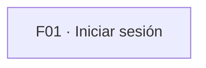

<!-- Generado por orquesta. No lo edites a mano. -->
# Índice de flujos

| Flujo | Funcionalidad | Estado | Versión | Pasos | Problemas | Archivos |
| --- | --- | --- | --- | --- | --- | --- |
| F01 · Iniciar sesión | FUN-03 | aprobado | 2 | 10 | — | [ficha](F01-iniciar-sesion.md) · [mapa](F01-iniciar-sesion.excalidraw) · [fuente](F01-iniciar-sesion.flow.json) |

## Mapa de flujos

